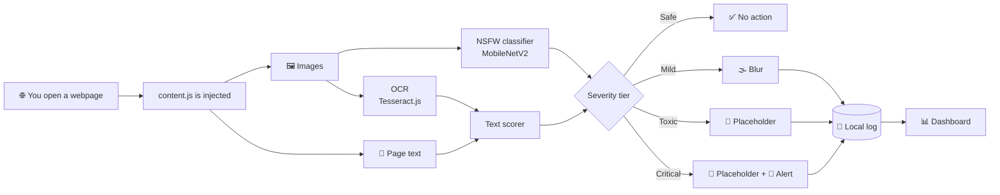
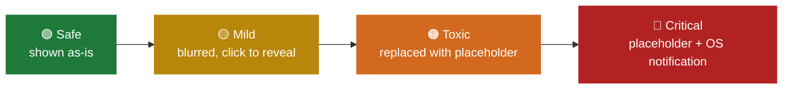
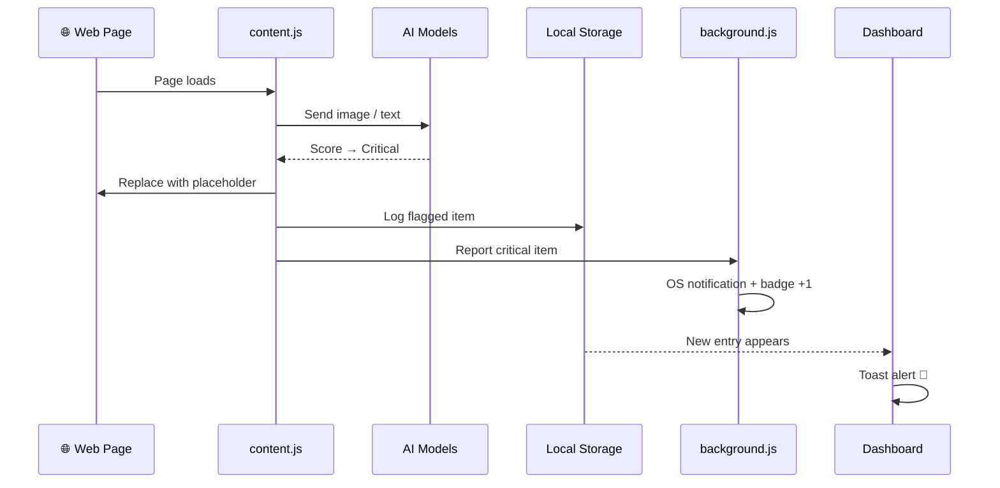
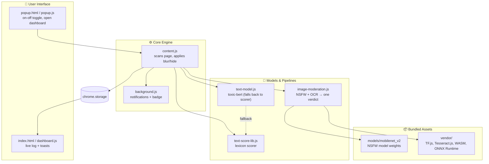

<p align="center">
  
</p>

<p align="center">
  
</p>

<p align="center">
  
  
  
  
  
</p>

<p align="center">
  <a href="#-features">Features</a> •
  <a href="#-how-it-works">How It Works</a> •
  <a href="#-installation">Installation</a> •
  <a href="#-architecture">Architecture</a> •
  <a href="#-challenges-solved">Challenges</a> •
  <a href="#-roadmap">Roadmap</a>
</p>

---

## 📖 About

**Moderation Guard** is a Chrome extension that scans web pages in real time — both **images** and **on-page text** — and flags harmful content by severity. It then acts automatically: it **blurs**, **hides**, **logs**, or **alerts**, depending on how serious the content is.

All AI models run **locally inside the browser**. Nothing you browse is sent to any server.

---

## ✨ Features

| | Feature | Description |
|---|---|---|
| 🖼️ | **Image classification** | A MobileNetV2-based NSFW model checks every image on the page |
| 🔤 | **OCR on images** | Tesseract.js reads text hidden inside memes and screenshots |
| 💬 | **Text scanning** | A lexicon-based scorer checks visible page text across 7 toxicity categories |
| 🎚️ | **Severity tiers** | Every item is rated **Safe / Mild / Toxic / Critical** |
| 🌫️ | **Auto-blur & hide** | Mild content is blurred (click to reveal); toxic and critical content is replaced with a placeholder |
| 🔔 | **Critical alerts** | OS notifications and a badge counter on the extension icon |
| 📊 | **Live dashboard** | A table of everything flagged, with toast alerts for new critical items |
| 🔁 | **Instant on/off toggle** | Turning filtering off reverses all effects instantly, with no page reload |

---

## ⚙️ How It Works



### Severity tiers



### What happens when a critical item is found



---

## 🚀 Installation

> No build step needed. The extension runs straight from the folder.

1. **Clone the repo**
   ```bash
   git clone https://github.com/Rakesh3652/moderation-guard.git
   ```
2. Open Chrome and go to **`chrome://extensions`**
3. Turn on **Developer mode** (toggle in the top-right corner)
4. Click **Load unpacked** and select the `moderation-guard` folder
5. Pin the 🛡️ icon to your toolbar, then browse any page

### Using it

- **Click the extension icon** to turn filtering on or off, or to open the dashboard
- **Click a blurred item** to reveal it
- **Open the dashboard** to see a live log of everything flagged

---

## 🏗️ Architecture



<details>
<summary><b>📁 Project structure (click to expand)</b></summary>

```
moderation-guard/
├── manifest.json          # Permissions, scripts, accessible resources
├── background.js          # Notifications + unread badge count
├── content.js             # Core engine, injected into every page
├── popup.html / popup.js  # Toolbar popup: toggle + open dashboard
├── index.html             # Dashboard page
├── dashboard.js           # Live table of flagged items + toasts
├── image-moderation.js    # Image pipeline: NSFW model + OCR
├── text-model.js          # toxic-bert loader (currently falls back)
├── text-score-lib.js      # Lexicon-based text scorer
├── clip-model.js          # CLIP visual recognition (in progress)
├── transformers-lib.js    # transformers.js loader (in progress)
├── script.js / style.css / image-app.js   # Dashboard layout + test panels
├── models/
│   └── mobilenet_v2/      # NSFW model.json + weight shards
└── vendor/                # Self-hosted TF.js, Tesseract.js, WASM binaries,
                           # English OCR data, transformers.js runtime
```

</details>

---

## 🧠 Models Used

| Model | Purpose | Status |
|---|---|---|
| **MobileNetV2 NSFW classifier** ([GantMan/nsfw_model](https://github.com/GantMan/nsfw_model)) | Classifies images: drawing / hentai / neutral / porn / sexy | ✅ Working |
| **Tesseract.js** (LSTM engine) | Reads text embedded in images | ✅ Working |
| **Lexicon scorer** | Scores page text and OCR text across 7 categories | ✅ Working |
| **toxic-bert** (via transformers.js) | Real semantic understanding of text | 🚧 In progress |
| **CLIP** | Recognises stylised or artistic image content | 🚧 In progress |

---

## 🧩 Challenges Solved

Running AI models **inside a Chrome extension** is much harder than on a normal webpage, because of Manifest V3 security rules.

<details>
<summary><b>1. Default model hosting went offline</b></summary>

The NSFW library's default model was taken down by its maintainers. **Fix:** downloaded and self-hosted the model files inside the extension.
</details>

<details>
<summary><b>2. Wrong model format</b></summary>

The files were in TensorFlow's *GraphModel* format, but the library expected the older *LayersModel* format. **Fix:** skipped the library's loader and loaded the model directly with TensorFlow.js.
</details>

<details>
<summary><b>3. No code from the internet at runtime</b></summary>

Manifest V3 blocks loading scripts from CDNs. **Fix:** bundled every library (TensorFlow.js, Tesseract.js) inside the `vendor/` folder.
</details>

<details>
<summary><b>4. <code>eval()</code> is forbidden</b></summary>

TensorFlow's default backend uses `eval()` internally. **Fix:** switched to the WebAssembly-only backend.
</details>

<details>
<summary><b>5. WASM backend needed 3 binaries</b></summary>

The plain, SIMD, and threaded variants all had to be registered, not just one.
</details>

<details>
<summary><b>6. Cross-origin images</b></summary>

Browsers block reading pixels from images hosted on other domains. **Fix:** load a CORS-safe copy, and skip images that don't allow it.
</details>

<details>
<summary><b>7. OCR file loading</b></summary>

Tesseract.js needed exact filename matches across 5 files (library, worker, WASM engine, language data). Fixed after several rounds of careful debugging.
</details>

<details>
<summary><b>8. Reversible on/off toggle</b></summary>

At first, turning filtering off didn't undo blurs that were already applied. **Fix:** separated scanning from the visual effect, so effects can be removed instantly.
</details>

---

## ⚠️ Known Limitations

| Limitation | Why | Planned fix |
|---|---|---|
| Text uses keyword matching, not real understanding | toxic-bert is blocked by the same CDN rule | Self-host transformers.js |
| OCR can't read stylised or artistic text | OCR reads character shapes, not overall visuals | Add CLIP |
| Some cross-origin images can't be checked | Browser security rules | Backend proxy (FastAPI) |
| Each tab loads its own copy of the models | Content scripts are isolated | Move inference to background or backend |
| Misspellings and leetspeak slip past keywords | Keyword lists can't cover everything | A trained model |

---

## 🗺️ Roadmap

- [x] NSFW image classification
- [x] OCR on images
- [x] Lexicon text scorer with severity tiers
- [x] Blur / hide / log / alert actions
- [x] Live dashboard and reversible toggle
- [ ] 🚧 CLIP-based visual recognition
- [ ] 🚧 Self-hosted transformers.js → toxic-bert
- [ ] Fine-tuned RoBERTa on Jigsaw + HatEval + OLID, focused on reducing demographic bias
- [ ] FastAPI backend (proxy + shared inference)
- [ ] Moderator dashboard with explainability
- [ ] Android app

---

## 🛠️ Tech Stack

<p>
  
</p>

- **Platform:** Chrome Extension (Manifest V3)
- **Image AI:** TensorFlow.js (WASM backend) + MobileNetV2
- **OCR:** Tesseract.js (LSTM)
- **Text AI:** Lexicon scorer, with transformers.js + toxic-bert coming soon
- **Storage:** `chrome.storage` (local only)

---

## 👤 Author

**Rakesh Prajapati**
B.E. Computer Engineering (Cyber Security), TCET Mumbai

[](https://github.com/Rakesh3652)

---

<p align="center">
  
</p>

<p align="center">⭐ If you found this project useful, consider giving it a star!</p>
